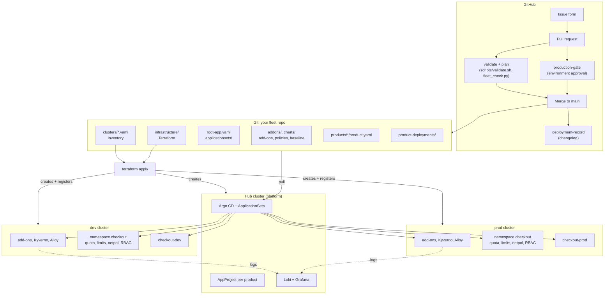

# Reference architecture

One page that connects every part of the fleet. Each box links to the folder that implements it.

## Layers

| Layer | Implemented by | Changes when | Who |
| --- | --- | --- | --- |
| Infrastructure | [infrastructure/](../infrastructure/) (Terraform) | A cluster is added, removed or upgraded | Platform |
| Inventory | [clusters/*.yaml](../clusters/) | Same; also drives labels and add-ons | Platform |
| GitOps controller | Argo CD via [modules/fleet-hub](../infrastructure/modules/fleet-hub/), values in [infrastructure/argocd/](../infrastructure/argocd/) | Argo CD upgrades (Renovate PR) | Platform |
| Fleet templates | [root-app.yaml](../root-app.yaml), [applicationsets/](../applicationsets/) | A new capability for every cluster or product | Platform |
| Platform capabilities | [addons/](../addons/), Helm add-ons in [platform-helm-addons-appset.yaml](../applicationsets/platform-helm-addons-appset.yaml) | Add-on versions, policies | Platform |
| Product contract | [products/*/product.yaml](../products/), [charts/product-namespace](../charts/product-namespace/), [charts/product-project](../charts/product-project/) | Onboarding, new environment, size | Product proposes, platform approves |
| Product workloads | [product-deployments/](../product-deployments/) | Every release | Product |
| Operations visibility | [.github/workflows/deployment-record.yaml](../.github/workflows/deployment-record.yaml), [scripts/trace.sh](../scripts/trace.sh), Loki/Grafana | Continuously | Both |

## Generated Applications

`python3 scripts/fleet_check.py` prints the current list. For two clusters and one product:

| ApplicationSet | Generator | Applications |
| --- | --- | --- |
| `platform-namespaces` | git files `clusters/*.yaml` | `dev-platform-namespaces`, `prod-platform-namespaces` |
| `platform-helm-addons` | matrix: clusters × list of charts | `dev-cert-manager`, `prod-kyverno`, ... (7 per cluster) |
| `kyverno-policies` | git files `clusters/*.yaml` | `dev-kyverno-policies`, `prod-kyverno-policies` |
| `observability-agents` | git files `clusters/*.yaml` | `dev-observability-agent`, `prod-observability-agent` |
| (Applications) | none, hub only | `platform-loki`, `platform-grafana` |
| `product-projects` | git files `products/*/product.yaml` | `product-checkout-project` |
| `product-namespaces` | matrix(matrix(products, their environments), clusters by label) | `checkout-dev-baseline`, `checkout-prod-baseline` |
| `product-apps` | same | `checkout-dev`, `checkout-prod` |

Platform ApplicationSets read the inventory files directly; product ApplicationSets select registered clusters by the labels Terraform derived from those same files. Either way, `clusters/*.yaml` is the source of truth.

## Production checklist

The repository is production-shaped, not production. Work through this with your team:

| Area | Do |
| --- | --- |
| Repositories | Split infrastructure, platform fleet and product deployment repos; one product repo per team |
| Terraform | Remote state with locking; plan on PR, apply from CI with OIDC; cloud modules instead of scripts |
| Argo CD | HA profile ([values-prod.yaml](../infrastructure/argocd/values-prod.yaml)), SSO, RBAC per team, admin user disabled, webhooks instead of polling |
| Spoke access | Workload identity or scoped ServiceAccounts per spoke; no admin certificates |
| Tenancy | Per-product AppProjects (done), SSO groups for `owner`, Argo CD RBAC so teams only see their projects |
| Policies | Kyverno in Enforce everywhere that matters; policy exceptions via reviewed PRs |
| Secrets | External Secrets with a cloud secret store and workload identity (`secretStore` in the baseline chart) |
| Delivery | Promotion by PR (done); consider ApplicationSet progressive sync or Argo Rollouts canaries for prod |
| Visibility | Argo CD Notifications updating GitHub deployment status and chat; dashboards per product |
| Recovery | Rehearse rebuilding the hub from Git; back up persistent volumes (Velero or cloud snapshots) |
| Upgrades | Kubernetes and add-ons wave by wave (`upgradeWave`), on a schedule; Renovate PRs reviewed weekly |
| Cost | Quotas per size (done); cost-center labels (done) exported to your cost tool |
